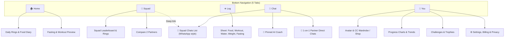

prompt for theme toggle :- You are given a task to integrate an existing React component in the codebase

The codebase should support:

- shadcn project structure
- Tailwind CSS
- Typescript

If it doesn't, provide instructions on how to setup project via shadcn CLI, install Tailwind or Typescript.

Determine the default path for components and styles.
If default path for components is not /components/ui, provide instructions on why it's important to create this folder
Copy-paste this component to /components/ui folder:

```tsx
animated - theme - toggler.tsx;
('use client');

import { useEffect, useRef, useState, useCallback } from 'react';
import { flushSync } from 'react-dom';

import { Moon, Sun } from 'lucide-react';

import { motion, AnimatePresence } from 'framer-motion';

import { cn } from '@/lib/utils';

type AnimatedThemeTogglerProps = {
  className?: string;
};

export const AnimatedThemeToggler = ({ className }: AnimatedThemeTogglerProps) => {
  const buttonRef = useRef<HTMLButtonElement>(null);
  const [darkMode, setDarkMode] = useState(() =>
    typeof window !== 'undefined' ? document.documentElement.classList.contains('dark') : false,
  );

  useEffect(() => {
    const syncTheme = () => setDarkMode(document.documentElement.classList.contains('dark'));

    const observer = new MutationObserver(syncTheme);
    observer.observe(document.documentElement, {
      attributes: true,
      attributeFilter: ['class'],
    });
    return () => observer.disconnect();
  }, []);

  const onToggle = useCallback(async () => {
    if (!buttonRef.current) return;

    await document.startViewTransition(() => {
      flushSync(() => {
        const toggled = !darkMode;
        setDarkMode(toggled);
        document.documentElement.classList.toggle('dark', toggled);
        localStorage.setItem('theme', toggled ? 'dark' : 'light');
      });
    }).ready;

    const { left, top, width, height } = buttonRef.current.getBoundingClientRect();
    const centerX = left + width / 2;
    const centerY = top + height / 2;
    const maxDistance = Math.hypot(
      Math.max(centerX, window.innerWidth - centerX),
      Math.max(centerY, window.innerHeight - centerY),
    );

    document.documentElement.animate(
      {
        clipPath: [
          `circle(0px at ${centerX}px ${centerY}px)`,
          `circle(${maxDistance}px at ${centerX}px ${centerY}px)`,
        ],
      },
      {
        duration: 700,
        easing: 'ease-in-out',
        pseudoElement: '::view-transition-new(root)',
      },
    );
  }, [darkMode]);

  return (
    <button
      ref={buttonRef}
      onClick={onToggle}
      aria-label="Switch theme"
      className={cn(
        'flex items-center justify-center p-2 rounded-full outline-none focus:outline-none active:outline-none focus:ring-0 cursor-pointer',
        className,
      )}
      type="button"
    >
      <AnimatePresence mode="wait" initial={false}>
        {darkMode ? (
          <motion.span
            key="sun-icon"
            initial={{ opacity: 0, scale: 0.55, rotate: 25 }}
            animate={{ opacity: 1, scale: 1, rotate: 0 }}
            exit={{ opacity: 0 }}
            transition={{ duration: 0.33 }}
            className="text-white"
          >
            <Sun />
          </motion.span>
        ) : (
          <motion.span
            key="moon-icon"
            initial={{ opacity: 0, scale: 0.55, rotate: -25 }}
            animate={{ opacity: 1, scale: 1, rotate: 0 }}
            exit={{ opacity: 0 }}
            transition={{ duration: 0.33 }}
            className="text-black"
          >
            <Moon />
          </motion.span>
        )}
      </AnimatePresence>
    </button>
  );
};

demo.tsx;
import { AnimatedThemeToggler } from '@/components/ui/animated-theme-toggler';

export default function ThemeSwitchDemo() {
  return (
    <div className="min-h-screen flex items-center justify-center bg-background transition-colors">
      <AnimatedThemeToggler />
    </div>
  );
}
```

Install NPM dependencies:

```bash
lucide-react, framer-motion
```

Implementation Guidelines

1.  Analyze the component structure and identify all required dependencies
2.  Review the component's argumens and state
3.  Identify any required context providers or hooks and install them
4.  Questions to Ask

- What data/props will be passed to this component?
- Are there any specific state management requirements?
- Are there any required assets (images, icons, etc.)?
- What is the expected responsive behavior?
- What is the best place to use this component in the app?

Steps to integrate 0. Copy paste all the code above in the correct directories

1.  Install external dependencies
2.  Fill image assets with Unsplash stock images you know exist
3.  Use lucide-react icons for svgs or logos if component requires them

layout :-
Here is the in-depth architectural breakdown and finalized layout structure for **CaliPartner**.

---

### The Root Cause of the Current Confusion

Looking closely at your current layout, there are **three structural flaws** causing the confusion:

1. **The "You" vs. "Profile / Me" Split:**\
   You currently have both a `Progress (You)` tab and a `Settings (Me)` tab. In modern mobile design, having two separate tabs for yourself confuses users (_"Where are my stats? Where is my avatar? Where are my settings?"_). This wastes a bottom-bar slot.
2. **Chat is Buried 3 Levels Deep:**\
   Chat currently lives as an internal segment inside `Squad` (`room.tsx`), tied to one squad at a time. If a user is in 2 or 3 squads (or has a 1-on-1 partner), they have no central inbox, no unified unread badges, and must manually switch squads via a dropdown to see if someone texted.
3. **Home vs. You Diary Duplication:**\
   Food diary entries appear on Home _and_ inside the "You" tab diary segment, making the user wonder where daily logging actually belongs.

---

### The Finalized 5-Tab Layout Architecture

By merging `Progress + Profile + Avatar` into a single **"You"** tab, you free up the bottom bar to give **"Chat"** its own dedicated, high-engagement tab—exactly as your co-founder envisioned.

```
┌───────────┬───────────┬───────────┬───────────┬───────────┐
│   Home    │   Squad   │   [ + ]   │   Chat    │    You    │
│  (Today)  │(Community)│   (Log)   │(Messenger)│ (Profile) │
└───────────┴───────────┴───────────┴───────────┴───────────┘
```

---

### Tab-by-Tab Breakdown

#### Tab 1: 🏠 Home (Daily Cockpit & Diary)

I would tell in chat

#### Tab 2: 👥 Squad (Accountability & Leaderboards)

_Purpose: Social comparison, motivation, and seeing how your accountability partners are doing._

- **Header:**
  - Squad Switcher Dropdown (switch between your 2–3 squads or pair room).
  - "+ Join / Create Squad" button.
- **Squad Members Overview:**
  - Live partner progress rings (% of own goal achieved—never judging raw calories).
  - "Nudge" button to send quick motivation if a partner hasn't logged lunch.
- **Compare Two People:**
  - Side-by-side macro/consistency comparison with privacy locks respected.
- **Squad Leaderboard & Milestone Feed:**
  - Weekly cohort ranking by consistency score.
  - Feed showing milestones (_"David logged his workout"_, _"Sarah hit 10k steps"_).
- **CTA Button:**
  - Prominent **"Open Squad Chat"** button at the top/bottom that deep-links directly into that squad's chat thread in the Chat tab.

---

#### Tab 3: ➕ Quick Log Hub (Floating Glass Action Sheet)

_Purpose: Single-tap modal sheet for logging anything instantly from anywhere._

- **Log Grid Tiles:**
  1. 🥗 **Food** (Opens food search + Barcode & AI camera scan buttons).
  2. 🏋️ **Workout** (Routines, exercise picker, set logger).
  3. 💧 **Water** (Quick +250ml / +500ml or custom amount).
  4. 🚴 **Cardio / GPS** (Run, walk, cycling tracking).
  5. ⚖️ **Weight** (Today's scale entry with moving average trend).
  6. ⏱️ **Fasting** (Start / Stop fast timer).

---

#### Tab 4: 💬 Chat (WhatsApp-Style Unified Messenger Hub)

_Purpose: The co-founder's vision. A clean, familiar messaging hub for all group and private fitness conversations._

```
┌────────────────────────────────────────────────────────┐
│  Chats                                   [🔍 Search]   │
├────────────────────────────────────────────────────────┤
│  ⭐ PINNED                                             │
│  🤖 AI Coach                                   10:45 AM│
│     "Great job hitting 140g protein yesterday!..." (1) │
├────────────────────────────────────────────────────────┤
│  👥 SQUADS & GROUPS                                    │
│  🔥 Morning Beasts (4 members)                 11:20 AM│
│     Rahul: Just finished leg day 💪                (3) │
│                                                        │
│  🏃 Sunday Runners (2 members)                Yesterday│
│     Priya: Are we running 5k tomorrow?                 │
├────────────────────────────────────────────────────────┤
│  👤 1-ON-1 PARTNERS                                    │
│  🤝 Alex (Primary Partner)                     09:15 AM│
│     You: Don't forget to drink water!       ✓✓         │
└────────────────────────────────────────────────────────┘
```

- **Section 1: AI Coach (Pinned at Top):**
  - Highlights your conversational AI coach (Claude Haiku / Pro tier).
  - Immediate access to ask nutrition questions, recipe substitutes, or meal advice.
- **Section 2: Squad Groups:**
  - Lists every squad you belong to with squad avatar, squad name, member count, last message preview, unread badge count, and timestamp.
- **Section 3: 1-on-1 Accountability Partner Chats:**
  - Direct private messages with your paired accountability partner.
- **Chat Screen (when opening a thread):**
  - Full-screen messenger with WhatsApp-style features:
  - Double checkmarks (sent / delivered / read).
  - Media sharing (photo food checks, workout selfies via Cloudflare R2).
  - Member `@mentions`.

---

#### Tab 5: 👤 You (Personal Progress, Avatar & Settings)

_Purpose: Everything that defines "You"—your trends, your character, your rewards, and your account settings._

- **Top Header:**
  - User display name and `@username`.
  - ⚙️ **Settings Icon (Top-Right):** Opens account management, subscription/paywall, notifications, privacy toggles, health sync, and export data.
- **Avatar & CaliCash (CC) Showcase:**
  - Your styled 2D character avatar.
  - CC Balance badge (`🪙 1,250 CC`).
  - Direct buttons: **"Wardrobe"** (customize outfit/hair/skin) and **"Shop"** (CaliCash cosmetic store).
- **Segmented Tabs: [ Progress | Challenges ]**
  - **Progress View:**
    - 7d / 30d / 90d trend charts: Weight graph & BMI trend, Calorie adherence, Macro distribution, Daily steps.
    - Workout history calendar.
    - Macro growth review prompt (Plus 30d / Pro 7d AI review).
  - **Challenges View:**
    - Active 1-day, 7-day, 30-day challenges.
    - Trophy case & achievement badges.
    - Platform events (_Winter Arc_, etc.).

---

### Complete Feature Placement Matrix

| Feature                        | Primary Screen         | How User Accesses It                                     |
| :----------------------------- | :--------------------- | :------------------------------------------------------- |
| **Daily Food & Macro Diary**   | **Home**               | Center of Home screen + `+` buttons on meal slots        |
| **Barcode & AI Photo Scanner** | **Log (+)** & **Home** | Tap `+` → Food → Barcode / Camera icon                   |
| **Water Logging**              | **Home** & **Log (+)** | Water card on Home or Water tile in Log sheet            |
| **Fasting Timer**              | **Home** & **Log (+)** | Compact card on Home or Fasting tile in Log sheet        |
| **Workout Logging & Routines** | **Log (+)** & **Home** | Workout tile in Log sheet; scheduled card on Home        |
| **Squad Leaderboard & Rings**  | **Squad**              | Primary view in Squad tab                                |
| **Compare Two Partners**       | **Squad**              | "Compare" tool on Squad tab                              |
| **Squad Chat Groups**          | **Chat**               | Tap group in Chat tab (or tap "Open Chat" from Squad)    |
| **1-on-1 Partner Chat**        | **Chat**               | Under "1-on-1 Partners" in Chat tab                      |
| **AI Coach Chat**              | **Chat**               | Pinned at the very top of Chat tab                       |
| **Weight Trend & Graphs**      | **You**                | Progress segment in You tab                              |
| **Avatar Wardrobe & CC Shop**  | **You**                | Wardrobe / Shop buttons on Avatar card in You tab        |
| **Challenges & Trophies**      | **You** & **Squad**    | Challenges segment in You tab; group challenges in Squad |
| **Account, Billing & Privacy** | **You** (⚙️ Header)    | Gear icon in top-right of You tab                        |

---

### Visual Navigation Flow



---

### Why this Solves the Entire Problem

1. **Gives the Co-founder Exactly What They Envisioned:**\
   The `Chat` tab becomes an instant, familiar messaging experience where all conversations (squads, partner, AI coach) are organized with unread counters, timestamps, and search.
2. **Eliminates Duplicate Tabs:**\
   Merging `Progress` and `Me` into `You` removes the confusing boundary between your statistics and your profile.
3. **Keeps the App Fast and Practical:**\
   Daily tracking stays on `Home` and `+ Log`. Social accountability stays on `Squad`. Communication stays on `Chat`. Long-term progress stays on `You`. Every tab has **one clear job**.
